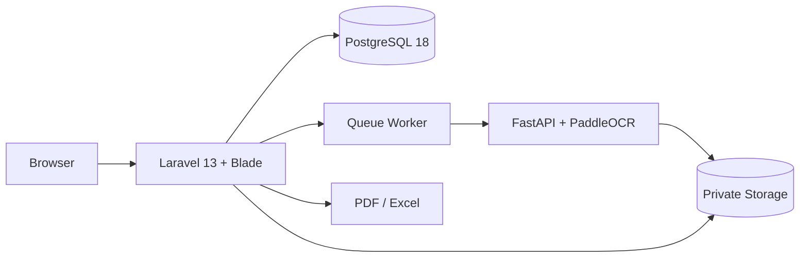

<div align="center">

# Kelola Uang Anda

Aplikasi keuangan pribadi untuk mencatat pemasukan, pengeluaran, transfer antar dompet, anggaran, dan target tabungan. Dilengkapi pemindaian struk melalui OCR serta laporan PDF dan Excel.

[](https://laravel.com)
[](https://www.php.net)
[](https://www.postgresql.org)
[](https://tailwindcss.com)
[](https://fastapi.tiangolo.com)

[Latar Belakang](#latar-belakang) · [Fitur](#fitur) · [Arsitektur](#arsitektur) · [Instalasi](#instalasi) · [Layanan OCR](#layanan-ocr) · [Pengujian](#pengujian) · [Struktur Proyek](#struktur-proyek)

</div>

## Latar Belakang

Ketika catatan keuangan tersebar di dompet, rekening, dan struk, saldo mudah berbeda dari transaksi yang sebenarnya. Pola pengeluaran juga sulit dibaca tanpa ringkasan yang rapi.

Kelola Uang Anda dibangun untuk menyatukan pencatatan pemasukan, pengeluaran, transfer antar dompet, anggaran, dan target tabungan dalam satu aplikasi. Saldo dompet dihitung dari transaksi agar sumber datanya tetap satu. Pemindaian struk ditambahkan untuk mengurangi ketikan manual, tetapi hasilnya tetap diperiksa pengguna sebelum menjadi transaksi.

Tahap awal aplikasi ditujukan untuk pengguna individu. Arsitektur dan pembagian data per pengguna disiapkan agar fitur keluarga bisa ditambahkan kemudian.

## Tentang Proyek

Kelola Uang Anda adalah aplikasi web monolit Laravel dengan antarmuka Blade, Tailwind CSS, Alpine.js, dan Chart.js. Saldo dompet dihitung dari transaksi, bukan disimpan sebagai angka terpisah, sehingga perubahan transaksi langsung tercermin pada saldo.

Pemindaian struk memakai layanan Python terpisah berbasis FastAPI dan PaddleOCR. Hasil OCR tidak langsung menjadi transaksi. Pengguna harus memeriksa dan mengonfirmasi data terlebih dahulu.

Aplikasi ini belum di-deploy ke lingkungan publik. Panduan di bawah diarahkan untuk menjalankan proyek secara lokal. Alur kerja rinci tersedia di [`docs/WorkFlow.md`](docs/WorkFlow.md).

## Fitur

| Modul | Kemampuan |
| --- | --- |
| Dashboard | Ringkasan saldo, pemasukan dan pengeluaran bulan berjalan, sisa anggaran, grafik arus kas, pengeluaran per kategori, transaksi terbaru |
| Dompet | CRUD dompet tunai, bank, dan e-wallet, saldo awal, status aktif |
| Kategori | Kategori pemasukan dan pengeluaran dengan warna dan ikon |
| Transaksi | CRUD pemasukan dan pengeluaran, filter jenis, dompet, kategori, tanggal, dan pencarian |
| Transfer | Perpindahan saldo antar dompet tanpa dihitung sebagai pemasukan atau pengeluaran |
| Anggaran | Anggaran bulanan per kategori pengeluaran, perhitungan pemakaian, status normal, peringatan, dan terlampaui |
| Scan Struk OCR | Unggah struk, ekstraksi teks, parsing item, koreksi manual, konfirmasi menjadi transaksi pengeluaran |
| Laporan | Laporan harian, mingguan, bulanan, tahunan, analisis kategori, ekspor PDF dan Excel |
| Target Tabungan | Target, tenggat, catatan setoran, progres, dan status tercapai atau terlewat |
| Profil | Nama, email, mata uang, zona waktu, dan perubahan kata sandi |

Saat pengguna baru mendaftar, aplikasi membuat satu dompet awal bernama `Tunai` dan 12 kategori bawaan. Tidak ada akun demo atau data produksi palsu.

## Arsitektur



Alur utama:

1. Pengguna mengunggah gambar struk.
2. Laravel memvalidasi berkas, menyimpannya di penyimpanan privat, lalu mengirim job OCR ke queue.
3. Queue worker memanggil layanan FastAPI.
4. PaddleOCR mengekstrak teks, parser mengubahnya menjadi data terstruktur.
5. Laravel menampilkan hasil untuk diperiksa pengguna.
6. Setelah dikonfirmasi, transaksi pengeluaran dibuat dan saldo dompet ikut berubah.

## Teknologi

| Lapisan | Teknologi |
| --- | --- |
| Backend | Laravel 13, PHP 8.3 |
| Database | PostgreSQL 18 |
| Tampilan | Blade, Tailwind CSS 4, Alpine.js 3 |
| Grafik | Chart.js 4 |
| Build | Vite 8 |
| OCR | FastAPI 0.104, PaddleOCR 3.2 |
| Ekspor | barryvdh/laravel-dompdf, maatwebsite/excel |
| Pengujian | PHPUnit 12, pytest |

## Kebutuhan Sistem

- PHP 8.3 dengan ekstensi `pdo_pgsql`, `pgsql`, `mbstring`, `openssl`, `fileinfo`, `gd`, `zip`, dan `bcmath`
- Composer 2
- Node.js 20 atau lebih baru dan npm
- PostgreSQL 18
- Python 3.10 atau lebih baru untuk layanan OCR

## Instalasi

### 1. Siapkan aplikasi Laravel

```bash
git clone <url-repositori> kelola-uang-anda
cd kelola-uang-anda
composer install
cp .env.example .env
php artisan key:generate
```

Di PowerShell, gunakan `Copy-Item .env.example .env` sebagai pengganti `cp`.

### 2. Siapkan database

Buat database PostgreSQL:

```sql
CREATE DATABASE kelola_uang_anda;
```

Sesuaikan bagian berikut di `.env`:

```env
DB_CONNECTION=pgsql
DB_HOST=127.0.0.1
DB_PORT=5432
DB_DATABASE=kelola_uang_anda
DB_USERNAME=isi_username
DB_PASSWORD=isi_password

APP_LOCALE=id
APP_TIMEZONE=Asia/Jakarta
```

Jalankan migrasi:

```bash
php artisan migrate
```

### 3. Build aset dan jalankan aplikasi

```bash
npm install
npm run build
php artisan serve
```

Untuk pengembangan dengan hot reload:

```bash
npm run dev
```

Buka `http://localhost:8000`.

### 4. Jalankan queue worker

Pemrosesan OCR berjalan sebagai job. Jalankan worker di terminal terpisah:

```bash
php artisan queue:work
```

Tanpa worker, struk akan tetap berstatus diproses dan tidak selesai.

## Layanan OCR

Layanan OCR berada di direktori `ocr_service`.

### 1. Pasang dependensi Python

```bash
cd ocr_service
python -m venv .venv
```

Aktivasi virtual environment:

```bash
# Linux atau macOS
source .venv/bin/activate

# Windows PowerShell
.venv\Scripts\Activate.ps1
```

Pasang paket:

```bash
pip install -r requirements.txt
```

PaddleOCR dapat mengunduh model saat pertama kali dijalankan. Proses ini membutuhkan koneksi internet dan waktu tambahan.

### 2. Atur token layanan

Layanan OCR menolak permintaan tanpa token yang cocok. Gunakan nilai acak yang panjang, lalu simpan nilai yang sama di dua tempat.

Di lingkungan layanan OCR:

```env
OCR_SHARED_SECRET=token-rahasia-anda
OCR_LANG=en
OCR_MAX_UPLOAD_BYTES=10485760
```

Di `.env` Laravel:

```env
OCR_SERVICE_URL=http://127.0.0.1:8001
OCR_SERVICE_TOKEN=token-rahasia-anda
OCR_SERVICE_TIMEOUT=60
```

Jangan commit nilai token ke repositori.

### 3. Jalankan layanan

Dari direktori `ocr_service`:

```bash
uvicorn app.main:app --host 127.0.0.1 --port 8001
```

Periksa layanan:

```bash
curl http://127.0.0.1:8001/health
```

Respons yang diharapkan:

```json
{"status":"ok"}
```

## Pengujian

Pengujian Laravel menggunakan SQLite in-memory, jadi tidak membutuhkan database PostgreSQL aktif.

```bash
php artisan test
```

Atau langsung melalui PHPUnit:

```bash
vendor/bin/phpunit
```

Format kode PHP:

```bash
vendor/bin/pint
vendor/bin/pint --test
```

Pengujian layanan OCR:

```bash
python -m pytest ocr_service/tests -q
```

Build aset produksi:

```bash
npm run build
```

Status terakhir: 98 tes PHP dengan 413 assertion, 7 tes OCR, Pint, dan build Vite lulus.

## Struktur Proyek

```text
app/
├── Enums/                 Enum tipe dompet, kategori, transaksi, status
├── Exports/               Ekspor laporan Excel
├── Http/
│   ├── Controllers/       Controller aplikasi
│   ├── Middleware/        Security headers
│   └── Requests/          Validasi Form Request
├── Jobs/                  Job pemrosesan OCR
├── Models/                Model Eloquent
├── Policies/              Pemeriksaan kepemilikan data
├── Services/              Logika transaksi, saldo, anggaran, laporan, OCR
└── Support/               Helper aritmetika uang berbasis bcmath

database/
├── factories/
├── migrations/
└── seeders/

ocr_service/
├── app/
│   ├── main.py            Endpoint FastAPI
│   ├── ocr.py             Integrasi PaddleOCR
│   ├── parser.py          Parser teks struk
│   └── config.py          Konfigurasi layanan
└── tests/

resources/
├── css/
├── js/
└── views/
    ├── components/
    ├── layouts/
    ├── receipts/
    ├── reports/
    └── saving-goals/

docs/
└── WorkFlow.md
```

## Keputusan Teknis

- Saldo dompet dihitung dari transaksi, bukan disimpan sebagai kolom saldo. Sumber kebenaran tetap satu dan saldo tidak bisa melenceng karena update ganda.
- Transfer disimpan sebagai satu baris transaksi dengan dompet sumber dan dompet tujuan. Transfer tidak masuk agregat pemasukan atau pengeluaran.
- Operasi uang memakai `DB::transaction` dan aritmetika `bcmath` dengan skala dua desimal. Tipe kolom uang adalah `decimal(15,2)`.
- Setoran target tabungan memakai `lockForUpdate` agar penambahan saldo tetap konsisten saat ada permintaan bersamaan.
- Setiap data milik pengguna dibatasi melalui query dan policy. Form Request memvalidasi kepemilikan dompet dan kategori sebelum data dipakai.
- Gambar struk disimpan di penyimpanan privat. Berkas tidak disajikan sebagai aset publik.
- Hasil OCR wajib dikonfirmasi pengguna sebelum transaksi dibuat.
- Respons web memakai header keamanan `X-Content-Type-Options`, `X-Frame-Options`, `Referrer-Policy`, dan `Permissions-Policy`.
- Login memiliki pembatasan percobaan dan pesan gagal yang tidak membocorkan apakah email terdaftar.

## Batasan dan Rencana

- Deployment publik belum dilakukan karena target hosting belum ditentukan.
- Layanan OCR berjalan terpisah dan membutuhkan PaddleOCR serta model yang sudah tersedia.
- Transaksi berulang dan notifikasi belum diimplementasikan.
- Mata uang utama aplikasi adalah IDR. Preferensi mata uang pada profil belum mengubah seluruh format tampilan.
- Pemindaian struk bergantung pada kualitas gambar. Koreksi manual tetap diperlukan untuk hasil yang tidak akurat.

## Kontribusi

Fork repositori, buat branch terpisah, lalu ajukan pull request. Jalankan `php artisan test`, `vendor/bin/pint --test`, dan `python -m pytest ocr_service/tests -q` sebelum mengirim perubahan.

## Lisensi

Lisensi MIT dideklarasikan di `composer.json`. Repositori ini belum menyertakan file `LICENSE`; tambahkan file tersebut sebelum publikasi.
