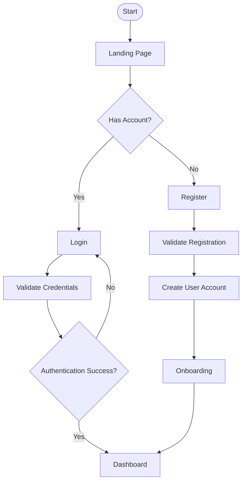
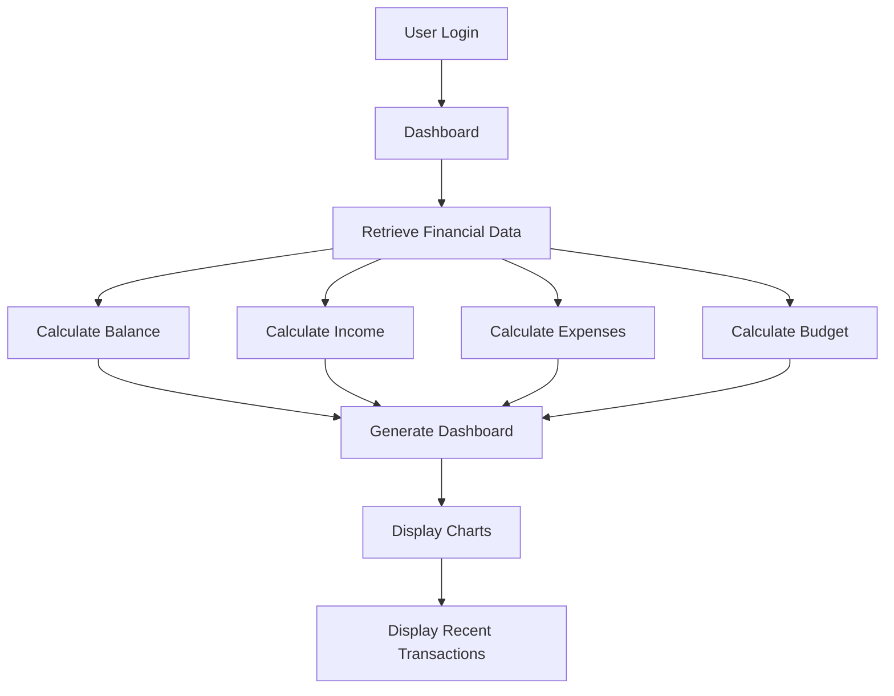
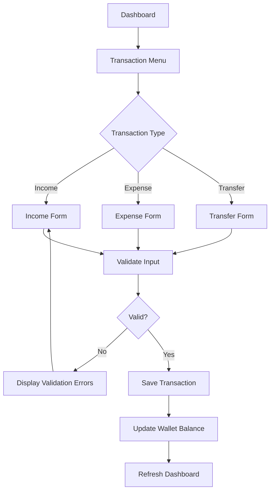
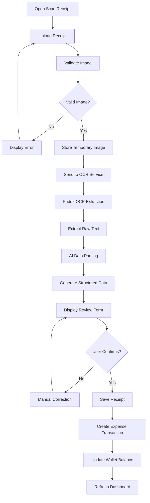
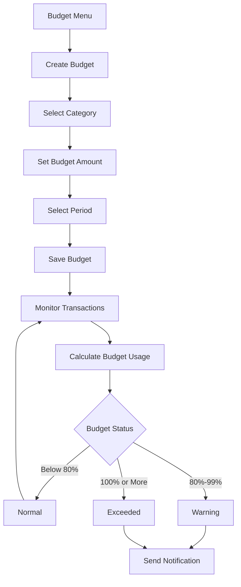
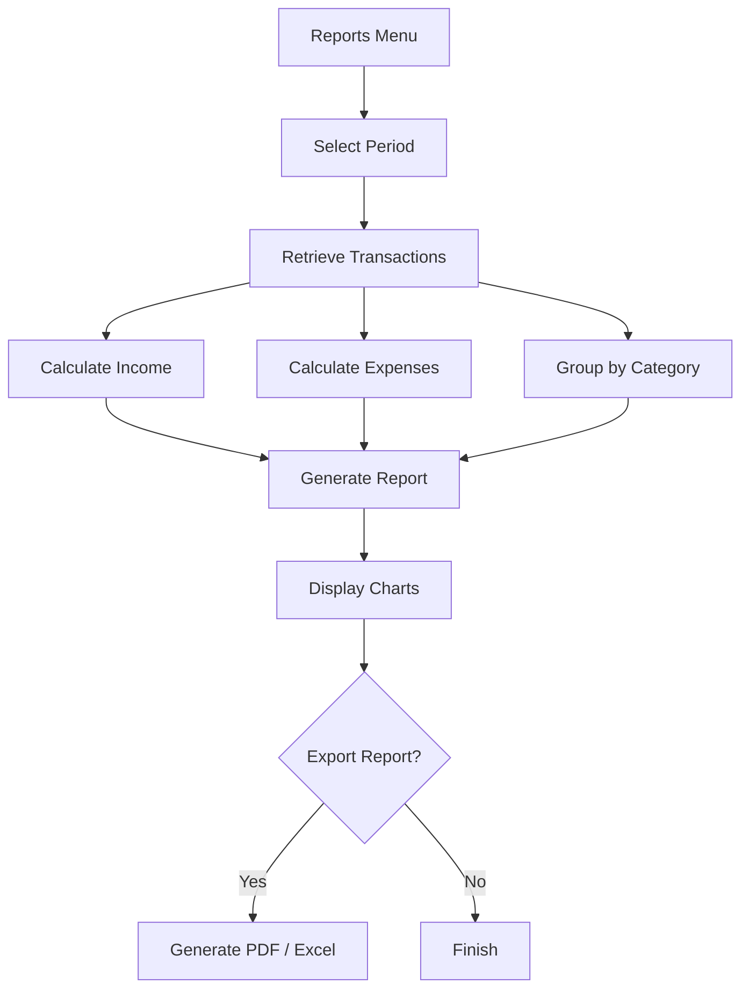
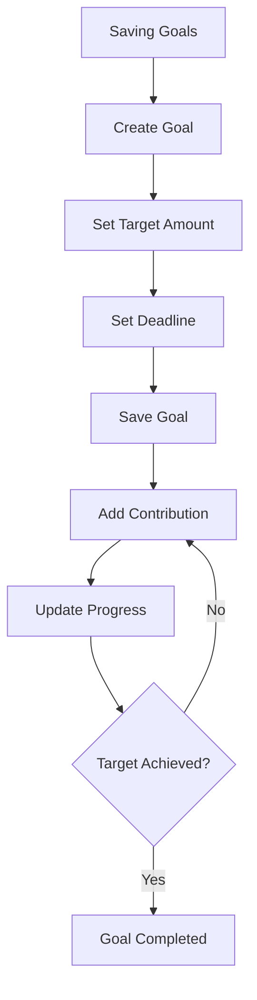
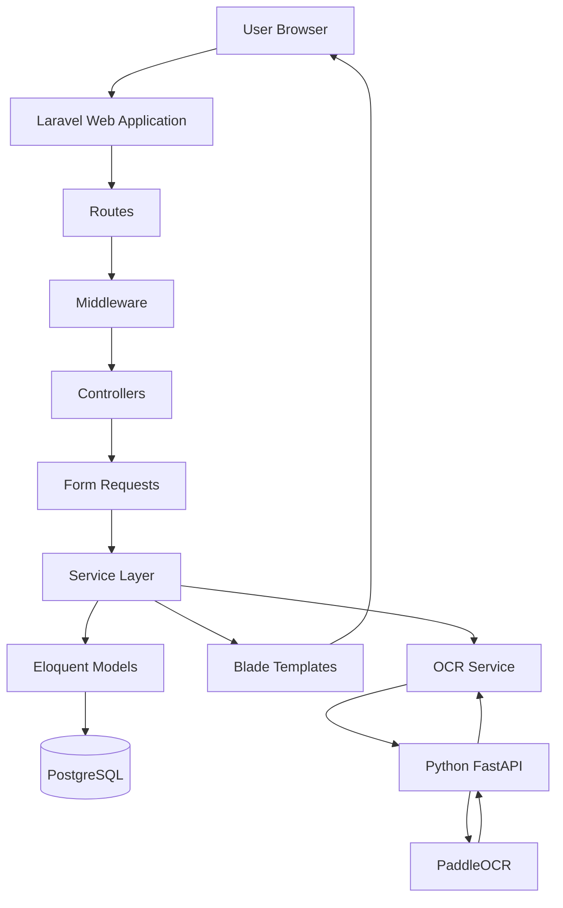
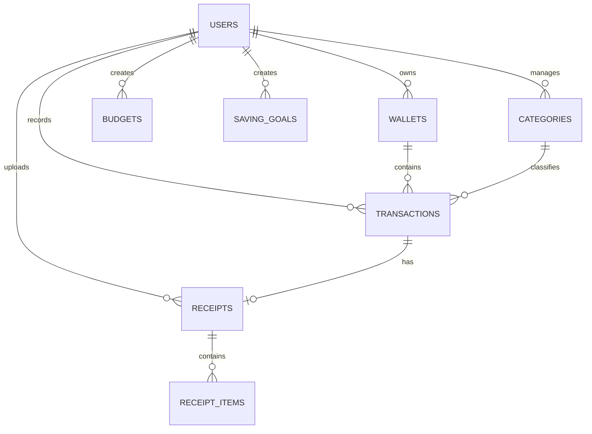

# WORKFLOW PROJECT
# K E L O L A  U A N G  A N D A

**Personal Finance Management Website**

| Informasi | Detail |
|---|---|
| Nama Aplikasi | Kelola Uang Anda |
| Jenis Aplikasi | Personal Finance Management |
| Backend | Laravel |
| Frontend | Laravel Blade |
| Database | PostgreSQL |
| CSS Framework | Tailwind CSS |
| JavaScript | Alpine.js |
| Chart Library | Chart.js |
| OCR Engine | PaddleOCR |
| OCR Integration | Python FastAPI |
| Architecture | Monolithic Laravel + External OCR Service |

---

# 1. PROJECT OVERVIEW

## 1.1 Deskripsi Aplikasi

Kelola Uang Anda merupakan aplikasi berbasis website yang dirancang untuk membantu pengguna dalam mengelola, memantau, dan menganalisis kondisi keuangan pribadi.

Aplikasi menyediakan fitur pencatatan pemasukan dan pengeluaran, pengelolaan saldo, pengaturan anggaran, laporan keuangan, serta pemindaian struk belanja menggunakan teknologi OCR dan AI.

Tujuan utama aplikasi adalah memberikan kemudahan kepada pengguna dalam mencatat setiap aktivitas keuangan dan memahami pola pengeluaran secara lebih terstruktur.

## 1.2 Tujuan Pengembangan

1. Mempermudah pencatatan pemasukan dan pengeluaran.
2. Menyediakan informasi kondisi keuangan secara terpusat.
3. Membantu pengguna mengontrol pengeluaran melalui fitur budgeting.
4. Mengotomatisasi pencatatan transaksi menggunakan scan receipt.
5. Menyediakan laporan dan visualisasi kondisi keuangan.
6. Membantu pengguna mencapai target tabungan.

## 1.3 Target Pengguna

Tahap pertama aplikasi difokuskan untuk penggunaan individu (Personal Finance).

Arsitektur aplikasi tetap dirancang agar memungkinkan pengembangan fitur Family Finance pada masa mendatang.

---

# 2. TECHNOLOGY STACK

| Layer | Technology | Responsibility |
|---|---|---|
| Backend | Laravel | Business logic, routing, authentication |
| Frontend | Blade | Server-side rendering |
| Database | PostgreSQL | Relational data storage |
| CSS | Tailwind CSS | UI styling |
| JavaScript | Alpine.js | Interactive components |
| Charts | Chart.js | Financial visualization |
| OCR | PaddleOCR | Text extraction |
| OCR API | Python FastAPI | OCR processing service |
| Storage | Laravel Storage | Receipt image storage |

## 2.1 Architecture Approach

Aplikasi menggunakan pendekatan monolithic architecture untuk backend utama.

Laravel bertanggung jawab terhadap seluruh proses bisnis aplikasi, sedangkan Python FastAPI digunakan sebagai service terpisah khusus untuk pemrosesan OCR.

Frontend menggunakan Blade sehingga tidak memerlukan framework SPA terpisah.

---

# 3. MAIN APPLICATION MODULES

Aplikasi terdiri dari delapan modul utama.

## 3.1 Authentication

Fitur:
- Register.
- Login.
- Logout.
- Forgot password.
- Reset password.
- Profile management.

## 3.2 Dashboard

Menampilkan ringkasan kondisi keuangan pengguna.

Komponen:
- Total balance.
- Total income.
- Total expenses.
- Remaining budget.
- Income vs expense chart.
- Expense category chart.
- Recent transactions.
- Saving goals progress.

## 3.3 Transaction Management

Mengelola seluruh transaksi keuangan.

Fitur:
- Create income.
- Create expense.
- Read transaction.
- Update transaction.
- Delete transaction.
- Search transaction.
- Filter by date.
- Filter by category.
- Filter by wallet.
- Transaction history.

Jenis transaksi:
- Income.
- Expense.
- Transfer.

## 3.4 Wallet Management

Mengelola berbagai sumber penyimpanan uang.

Contoh:
- Cash.
- Bank Account.
- E-Wallet.

Fitur:
- Create wallet.
- Update wallet.
- Delete wallet.
- View wallet balance.
- Wallet transaction history.
- Transfer between wallets.

## 3.5 Receipt Scanning

Mengotomatisasi pencatatan pengeluaran melalui gambar struk.

Fitur:
- Upload receipt.
- Camera capture.
- OCR extraction.
- AI-assisted data parsing.
- Receipt preview.
- Transaction review.
- Manual correction.
- Save as transaction.

## 3.6 Budget Management

Mengatur batas pengeluaran berdasarkan kategori dan periode.

Fitur:
- Create budget.
- Update budget.
- Delete budget.
- Budget progress.
- Budget warning.
- Budget history.

## 3.7 Financial Reports

Menyediakan laporan keuangan berdasarkan periode.

Fitur:
- Daily report.
- Weekly report.
- Monthly report.
- Yearly report.
- Income analysis.
- Expense analysis.
- Category analysis.
- Export PDF.
- Export Excel.

## 3.8 Saving Goals

Membantu pengguna menetapkan target tabungan.

Fitur:
- Create saving goal.
- Update target.
- Record saving contribution.
- Progress tracking.
- Goal completion status.

## 3.9 Settings

Fitur:
- User profile.
- Change password.
- Currency preferences.
- Notification preferences.
- Account management.

---

# 4. APPLICATION USER WORKFLOW

## 4.1 Authentication Workflow



Tahapan:

1. Pengguna membuka website.
2. Pengguna memilih Login atau Register.
3. Pengguna melakukan autentikasi.
4. Sistem memvalidasi data.
5. Pengguna baru menyelesaikan onboarding.
6. Pengguna diarahkan menuju Dashboard.

## 4.2 Dashboard Workflow



Dashboard menjadi pusat informasi seluruh aktivitas keuangan pengguna.

## 4.3 Transaction Workflow



Data transaksi meliputi:
- Transaction type.
- Wallet.
- Category.
- Amount.
- Transaction date.
- Description.
- Attachment (optional).

## 4.4 Receipt Scanning Workflow



### Data yang Diekstrak

| Field | Description |
|---|---|
| Merchant | Nama toko |
| Transaction Date | Tanggal transaksi |
| Item Name | Nama barang |
| Quantity | Jumlah barang |
| Unit Price | Harga satuan |
| Subtotal | Total harga barang |
| Tax | Pajak |
| Discount | Potongan harga |
| Total | Total pembayaran |
| Category | Kategori pengeluaran |

### OCR Processing Rules

1. Gambar harus divalidasi sebelum diproses.
2. Sistem harus membatasi ukuran dan format file.
3. OCR melakukan ekstraksi teks.
4. AI membantu mengubah teks menjadi struktur data.
5. Total pembayaran harus diperiksa konsistensinya.
6. Pengguna wajib melakukan konfirmasi sebelum transaksi disimpan.
7. Sistem menyimpan hasil ekstraksi untuk kebutuhan riwayat scan.

Hasil OCR tidak boleh langsung dianggap sebagai transaksi valid tanpa konfirmasi pengguna.

## 4.5 Budget Workflow



## 4.6 Financial Report Workflow



## 4.7 Saving Goals Workflow



---

# 5. SYSTEM ARCHITECTURE

## 5.1 Application Architecture



## 5.2 Backend Responsibilities

| Component | Responsibility |
|---|---|
| Routes | Define application endpoints |
| Middleware | Authentication and authorization |
| Controllers | Handle incoming requests |
| Form Requests | Validate user input |
| Services | Handle business logic |
| Models | Manage database interactions |
| Blade | Render application views |
| PostgreSQL | Persist application data |
| OCR Service | Process receipt images |

Recommended development pattern:

**Route → Middleware → Controller → Form Request → Service → Model → Database → Blade Response**

Business logic sebaiknya tidak ditempatkan seluruhnya di Controller.

---

# 6. DATABASE DESIGN

## 6.1 Database Tables

| Table | Responsibility |
|---|---|
| users | User information |
| wallets | Financial accounts |
| categories | Transaction categories |
| transactions | Income, expense, transfer records |
| receipts | Receipt image and extraction data |
| receipt_items | Extracted receipt item details |
| budgets | Financial budgets |
| saving_goals | Saving targets |
| notifications | User notifications |

## 6.2 Database Relationships



## 6.3 Important Database Rules

1. Gunakan PostgreSQL sebagai database utama.
2. Gunakan `DECIMAL(15,2)` untuk nominal keuangan.
3. Gunakan foreign key untuk menjaga integritas data.
4. Setiap transaksi harus memiliki user ownership.
5. Gunakan database transaction untuk operasi keuangan.
6. Gunakan indexing pada kolom yang sering digunakan untuk filtering.
7. Gunakan soft delete jika diperlukan untuk pemulihan data.
8. Jangan menyimpan gambar sebagai binary langsung di database.
9. Gunakan `JSONB` untuk menyimpan metadata hasil OCR jika diperlukan.

### Transaction Rules

- Income menambah saldo wallet.
- Expense mengurangi saldo wallet.
- Transfer mengurangi saldo wallet sumber dan menambah saldo wallet tujuan.
- Transfer tidak dihitung sebagai pemasukan atau pengeluaran eksternal.
- Editing dan deleting transaksi harus memperhitungkan dampaknya terhadap saldo.
- Semua operasi perubahan saldo harus dilakukan secara atomik.

---

# 7. LARAVEL PROJECT STRUCTURE

Target struktur folder:

```text
app/
├── Http/
│   ├── Controllers/
│   │   ├── Auth/
│   │   ├── DashboardController.php
│   │   ├── TransactionController.php
│   │   ├── WalletController.php
│   │   ├── CategoryController.php
│   │   ├── ReceiptController.php
│   │   ├── BudgetController.php
│   │   ├── ReportController.php
│   │   └── SavingGoalController.php
│   │
│   └── Requests/
│       ├── StoreTransactionRequest.php
│       ├── UpdateTransactionRequest.php
│       └── StoreReceiptRequest.php
│
├── Models/
│   ├── User.php
│   ├── Wallet.php
│   ├── Category.php
│   ├── Transaction.php
│   ├── Receipt.php
│   ├── ReceiptItem.php
│   ├── Budget.php
│   ├── SavingGoal.php
│   └── Notification.php
│
└── Services/
    ├── TransactionService.php
    ├── WalletService.php
    ├── ReceiptService.php
    ├── OcrService.php
    ├── BudgetService.php
    └── ReportService.php

resources/
└── views/
    ├── layouts/
    │   ├── app.blade.php
    │   └── guest.blade.php
    │
    ├── components/
    ├── auth/
    ├── dashboard/
    ├── transactions/
    ├── wallets/
    ├── categories/
    ├── receipts/
    ├── budgets/
    ├── reports/
    ├── saving-goals/
    └── settings/

routes/
├── web.php
└── console.php

database/
├── migrations/
├── seeders/
└── factories/

storage/
└── app/
    └── private/
        └── receipts/
```

Struktur ini merupakan target awal dan dapat disesuaikan dengan kebutuhan implementasi.

---

# 8. APPLICATION ROUTES

| Method | URI | Controller | Function |
|---|---|---|---|
| GET | / | Landing Page | index |
| GET | /login | Auth | login |
| GET | /register | Auth | register |
| GET | /dashboard | DashboardController | index |
| GET | /transactions | TransactionController | index |
| GET | /transactions/create | TransactionController | create |
| POST | /transactions | TransactionController | store |
| GET | /transactions/{id} | TransactionController | show |
| PUT | /transactions/{id} | TransactionController | update |
| DELETE | /transactions/{id} | TransactionController | destroy |
| GET | /wallets | WalletController | index |
| GET | /categories | CategoryController | index |
| GET | /receipts | ReceiptController | index |
| GET | /receipts/scan | ReceiptController | create |
| POST | /receipts/scan | ReceiptController | store |
| GET | /budgets | BudgetController | index |
| GET | /reports | ReportController | index |
| GET | /saving-goals | SavingGoalController | index |
| GET | /settings | SettingsController | index |

Seluruh route aplikasi yang bersifat privat wajib dilindungi middleware authentication dan authorization.

---

# 9. DEVELOPMENT ROADMAP

Pengembangan dibagi menjadi lima sprint.

## Sprint 1 - Foundation & Authentication

- [ ] Create Laravel project.
- [ ] Configure PostgreSQL.
- [ ] Configure environment.
- [ ] Setup migrations.
- [ ] Setup models and relationships.
- [ ] Implement registration.
- [ ] Implement login and logout.
- [ ] Implement authentication middleware.
- [ ] Create dashboard layout.
- [ ] Create initial dashboard.

**Expected Result:** Aplikasi memiliki fondasi backend dan autentikasi.

## Sprint 2 - Core Finance Management

- [ ] Wallet CRUD.
- [ ] Category CRUD.
- [ ] Income management.
- [ ] Expense management.
- [ ] Transfer management.
- [ ] Transaction history.
- [ ] Search and filtering.
- [ ] Balance calculation.
- [ ] Transaction validation.
- [ ] Feature tests.

**Expected Result:** Pengguna dapat mencatat dan mengelola seluruh transaksi keuangan.

## Sprint 3 - Dashboard & Budget

- [ ] Dashboard financial summary.
- [ ] Income vs expense chart.
- [ ] Expense category chart.
- [ ] Recent transactions.
- [ ] Budget CRUD.
- [ ] Budget calculation.
- [ ] Budget progress.
- [ ] Budget notifications.

**Expected Result:** Pengguna dapat memantau kondisi dan mengontrol anggaran.

## Sprint 4 - Receipt Scanning

- [ ] Receipt upload.
- [ ] Image validation.
- [ ] Secure image storage.
- [ ] Setup Python FastAPI.
- [ ] Install PaddleOCR.
- [ ] Implement OCR extraction.
- [ ] Implement AI-assisted parsing.
- [ ] Receipt review interface.
- [ ] Manual data correction.
- [ ] Save receipt transaction.
- [ ] OCR processing tests.

**Expected Result:** Pengguna dapat mencatat pengeluaran melalui pemindaian struk.

## Sprint 5 - Reports & Advanced Features

- [ ] Daily financial report.
- [ ] Weekly financial report.
- [ ] Monthly financial report.
- [ ] Yearly financial report.
- [ ] Export PDF.
- [ ] Export Excel.
- [ ] Saving goals.
- [ ] Recurring transactions.
- [ ] Security testing.
- [ ] Performance optimization.
- [ ] Deployment.

**Expected Result:** Aplikasi siap digunakan dengan fitur pengelolaan keuangan yang lebih lengkap.

---

# 10. SECURITY & VALIDATION REQUIREMENTS

Keamanan merupakan bagian wajib dari pengembangan aplikasi.

## Authentication
- Password harus di-hash.
- Gunakan session authentication Laravel.
- Implementasikan CSRF protection.
- Terapkan rate limiting pada login.

## Authorization
- Pengguna hanya dapat mengakses data miliknya.
- Validasi ownership setiap transaksi.
- Validasi ownership wallet dan category.
- Jangan mengandalkan ID dari frontend tanpa pemeriksaan backend.

## Financial Data
- Gunakan database transactions.
- Gunakan locking saat diperlukan untuk operasi saldo.
- Hindari floating-point arithmetic.
- Validasi nominal harus lebih besar dari nol.
- Hindari manipulasi saldo langsung dari frontend.

## Receipt Upload
- Batasi format gambar.
- Batasi ukuran file.
- Validasi MIME type.
- Gunakan private storage.
- Jangan mengeksekusi file upload.
- Jangan mempercayai hasil OCR tanpa konfirmasi pengguna.

## Testing
- Authentication tests.
- Authorization tests.
- Transaction CRUD tests.
- Balance calculation tests.
- Transfer consistency tests.
- Receipt upload tests.
- OCR parsing tests.
- Budget calculation tests.

---

# 11. MVP SCOPE

Versi pertama aplikasi harus memprioritaskan fitur berikut:

| Feature | Priority |
|---|---|
| Authentication | High |
| Dashboard | High |
| Income Management | High |
| Expense Management | High |
| Wallet Management | High |
| Category Management | High |
| Transaction History | High |
| Receipt Scanning | Medium |
| Budget Management | Medium |
| Financial Reports | Medium |
| Saving Goals | Low |
| AI Financial Assistant | Future |

MVP dianggap selesai apabila pengguna sudah dapat:

1. Membuat akun dan login.
2. Mengelola wallet.
3. Mencatat pemasukan.
4. Mencatat pengeluaran.
5. Melihat saldo secara akurat.
6. Melihat riwayat transaksi.
7. Melihat ringkasan kondisi keuangan.

---

# 12. FUTURE DEVELOPMENT

Pengembangan lanjutan yang dapat ditambahkan:

- AI Financial Assistant.
- Automatic expense categorization.
- Spending pattern analysis.
- Financial recommendations.
- Recurring transactions.
- Family finance management.
- Shared wallets.
- Advanced financial analytics.
- Multi-currency support.

---

# 13. DEVELOPMENT PRINCIPLES

Prinsip yang harus diterapkan selama pengembangan:

1. Gunakan clean and maintainable code.
2. Pisahkan business logic dari Controller.
3. Gunakan Form Request untuk validasi.
4. Gunakan Eloquent Relationship secara tepat.
5. Gunakan database transaction untuk operasi keuangan.
6. Terapkan authorization pada setiap data milik pengguna.
7. Hindari hardcoded configuration.
8. Buat testing untuk business logic penting.
9. Gunakan reusable Blade Components.
10. Dokumentasikan perubahan database dan fitur.

**Final Development Direction:**

Kelola Uang Anda dikembangkan menggunakan Laravel sebagai backend utama, PostgreSQL sebagai database, dan Blade sebagai frontend rendering engine.

Pengembangan dimulai dari fondasi autentikasi dan pengelolaan transaksi keuangan, kemudian dilanjutkan dengan dashboard, budgeting, receipt scanning berbasis OCR, dan laporan keuangan.

Fokus utama adalah menghasilkan aplikasi pengelolaan keuangan yang aman, akurat, mudah digunakan, dan dapat dikembangkan dalam jangka panjang.
